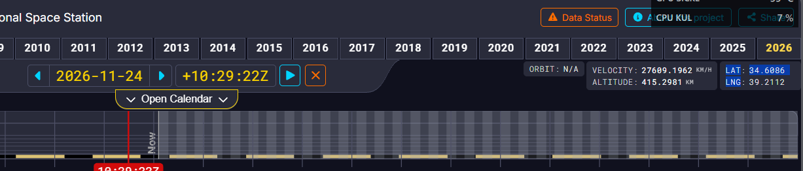

# Phase 0 — Setup

## Goal
Set up the development environment and verify it by computing the ISS's current position from a fresh TLE.

## What I did
I downloaded the ISS's TLE from CelesTrak. The TLE describes the ISS's orbit at a reference time (the epoch), which was about 12 hours before my run. I created a satellite object with skyfield's `EarthSatellite` and used SGP4 to fast-forward (propagate) its orbit to the current time. This gave me a plausible estimate of the ISS's current position. I also made my first git commit.

## Key concepts
- **TLE (Two-Line Element set):** a standard text format that describes a satellite's orbit at a reference time called the epoch.
- **SGP4:** the model that takes a TLE and calculates the satellite's position at any other time by fast-forwarding the orbit from the epoch.
- **Epoch:** the time the TLE refers to. It is crucial because the older the TLE, the less accurate the prediction.

## Result
```text
ISS (ZARYA)
1 25544U 98067A   26327.91294507  .00005691  00000+0  10921-3 0  9993
2 25544  51.6322 229.6520 0007379  58.6021 301.5689 15.49568558596519

ISS (ZARYA) catalog #25544 epoch 2026-11-23 21:54:38 UTC
Time (UTC): 2026-11-24 10:29:22 UTC
Latitude: 34.34 deg
Longitude: 38.85 deg
Height: 415.4 km
```

We can check the result by looking up the ISS's position at the same time.
I checked it on [Satflare](https://www.satflare.com/track.asp?q=25544) and it matched my result within about 1 km (34.33° N, 38.85° E, 415.4 km).

## Problems and lessons
If the TLE taken from CelesTrak is old enough, the calculation will be completely wrong. The code doesn't check the TLE age, so it may silently return a wrong position without raising any warning.

I also compared my result with another online ISS tracker. That tracker appeared to be about 6 seconds ahead, so its position was 34.61° N, 39.21° E. This is a difference of nearly 45 km, almost entirely along the orbit. So it is really crucial to synchronize the time.


